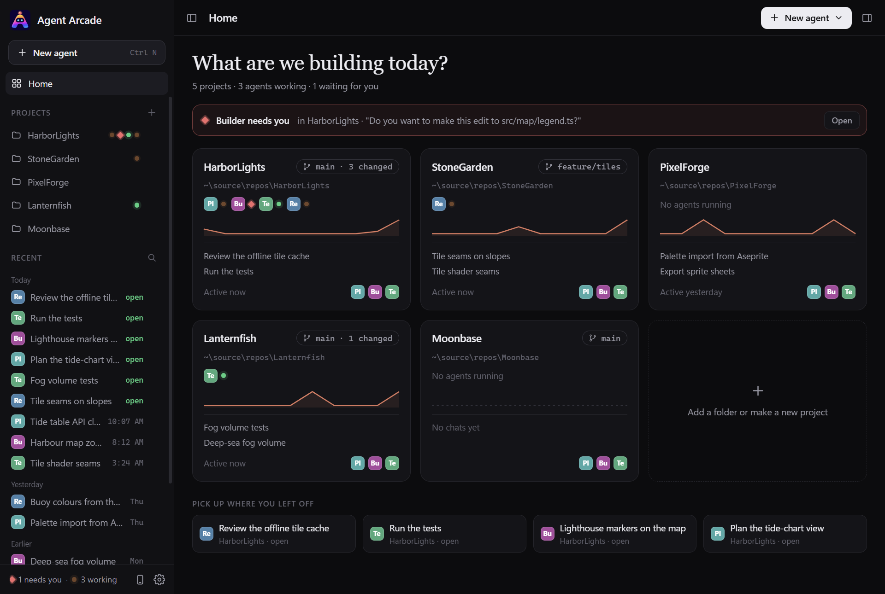

# Agent Arcade

**Every coding agent's own CLI, side by side on Windows, and one phone app that talks only to your PC.**

[Website](https://danular.github.io/AgentArcade/) · [Download](https://danular.github.io/AgentArcade/download.html) · [Pricing](https://danular.github.io/AgentArcade/pricing.html)

<!-- MEDIA SLOT, for Daan: the 20-second muted clip goes here, above the screenshots. Record it in a test copy with demo
     accounts (no live pairing QR code, no real emails, paths or terminal text) and keep it as docs/media/hero.mp4. GitHub
     plays a video inline only when it is uploaded through the README editor, so drag the file into this README on
     github.com and keep the user-attachments link it inserts on its own line here. -->

<p>
  
</p>
<p>
  
  
</p>

<sub>Screenshots from a test copy, with stand-in demo agents and made-up projects.</sub>

A Windows app that runs your AI coding agents side by side on one project: Claude Code, Codex (ChatGPT), GitHub Copilot CLI, Cursor, Antigravity CLI and Gemini CLI (API key or Code Assist), each in its own pane inside the app. Codex can also run a local model through Ollama (see [Local models](#local-models-ollama)).

Free for personal use. Professional use needs Agent Arcade Pro (EUR 25 per user per month excl. VAT); see [LICENSING.md](LICENSING.md). Pro checkout isn't open yet, and the voice dictation app planned for Pro is still coming.

## Known gaps

- Windows 11 on x64 only. Windows 10 and Windows on ARM aren't tested, and there is no Mac or Linux version.
- The phone app is Android only (8.0 or newer). There is no iPhone app. On an iPhone, Claude Code chats can open in Anthropic's Claude app instead, through Claude Code's own Remote Control (an opt-in per account, see [Phone remote](#phone-remote)); the other agents can't.
- No worktree isolation: agents in one project share its folder, and agents started without a project share Chats. Give them separate tasks, or open separate folders as separate workspaces.
- Agents don't survive an app restart. Closing Agent Arcade stops them; Recent in the sidebar can resume their chats afterwards.
- Status dots, alerts and phone approvals come from reading each agent's screen (approval prompts, "esc to interrupt" lines) and the notifications it sends. When a vendor changes its interface, a dot or an alert can be wrong until Agent Arcade catches up.
- Not code-signed yet: SmartScreen warns on first start, and Smart App Control blocks it, until the code-signing certificate arrives.

## How it differs (checked 16 Oct 2026)

Agent Arcade runs each vendor's own CLI, unmodified, in a Windows terminal pane (ConPTY), and its Android app connects only to your PC, over your Wi-Fi or Tailscale. It reads the terminal and never signs in to anything itself, so it works the same with a subscription, an API key, Amazon Bedrock or Google Cloud, and with Codex, GitHub Copilot CLI, Cursor and Gemini CLI as well as Claude Code. Each line links the product's own page as read on 16 Oct 2026, and says where it is ahead.

- **[Happy](https://github.com/slopus/happy)** has phone apps for iOS and Android, a web client and a desktop app for macOS, Windows and Linux, synced through its end-to-end encrypted relay server: ahead on iPhone, the browser and reaching you away from home without a VPN. Its original CLI wraps Claude Code and Codex, and its desktop app runs Happy's own agent runtime on your Claude, Codex and Grok subscriptions; Agent Arcade runs each vendor's CLI as it is, Copilot, Cursor and Gemini CLI included, with no Agent Arcade server in between.
- **[Paseo](https://paseo.sh/)** has native iOS and Android apps, a desktop app for macOS, Windows and Linux, a web app, a git worktree per agent, voice, and an optional end-to-end encrypted relay, a direct connection on your network or your own tunnel such as Tailscale: ahead on iPhone, Mac and Linux, worktree isolation and setup away from home. It shows agents in its own interface, through its own integrations or ACP; Agent Arcade shows each CLI's own terminal screen, on the PC and on the phone.
- **[Coucou](https://github.com/Louis-CFM/coucou)** lives in the Mac's notch (or the top of the screen on Windows and Linux) and watches agents that run in your own terminals, through their hooks, with an iPhone app in TestFlight beta on the Lock Screen and Dynamic Island, and an Android app by a contributor that talks to Coucou on Windows or Linux over your Wi-Fi: ahead on the Mac, the iPhone and fitting the terminal you already use. It watches agents and answers their approvals and questions; Agent Arcade runs the agents in its own panes, so the phone also reads the whole terminal, types to an agent, and starts, stops and resumes agents.
- **[Warp](https://docs.warp.dev/agents/cli-agents/overview)** is a full terminal for macOS, Windows and Linux (x64 and ARM64) that recognises Claude Code, Codex, GitHub Copilot CLI, Cursor CLI, Gemini CLI and more, with a rich input editor and code review comments, and its [Remote Control](https://docs.warp.dev/agents/cli-agents/remote-control/) opens a session in any browser, an iPhone's included: ahead as a terminal and on platforms. That Remote Control uploads the session to Warp's cloud; Agent Arcade's phone app gets agent screens straight from your PC.
- **[Claude Code Remote Control](https://code.claude.com/docs/en/remote-control)** is Anthropic's own, built into Claude Code, with the Claude app for iOS and Android, claude.ai/code in any browser, and a git worktree per session in server mode: ahead for Claude subscribers, with nothing extra to install. It needs a Pro, Max, Team or Enterprise plan (not an API key, Amazon Bedrock, Google Cloud or Microsoft Foundry), goes through Anthropic's servers, which store the session transcript, and covers Claude Code only; Agent Arcade also works for API-key, Bedrock and Google Cloud users, and with Codex, Copilot, Cursor and Gemini CLI.

## Download

1. Download [AgentArcade-win-x64.zip](https://github.com/danular/AgentArcade/releases/latest/download/AgentArcade-win-x64.zip) (the newest version; all versions are on the [releases page](https://github.com/danular/AgentArcade/releases)). It runs on Windows 11 (x64) and needs nothing else installed: the .NET runtime is inside the zip. If Microsoft Edge says the file isn't commonly downloaded, open the download's **⋯** menu, choose **Keep**, then **Show more** → **Keep anyway**.
2. Check the file: each release lists the zip's SHA-256 (so does the [download page](https://danular.github.io/AgentArcade/download.html#verify)). In PowerShell, in the download folder, this prints `True` when the file matches:
   ```powershell
   (Get-FileHash .\AgentArcade-win-x64.zip -Algorithm SHA256).Hash -eq '<SHA-256 from the release>'
   ```
3. Extract the zip to a folder of your choice, for example `%LOCALAPPDATA%\Programs\AgentArcade`. `AgentArcade.exe` is at the top of the zip; start it. Keep the files together: the app needs the `web` folder next to it. The first start adds **Agent Arcade** to your Start menu (for your Windows user only, no administrator rights), so from then on Start and Windows search find it.
4. The download isn't code-signed yet, so Windows SmartScreen may say it "protected your PC". Click **More info** → **Run anyway**. If Smart App Control is on, Windows blocks unsigned apps and has no per-app exception, so Agent Arcade can't run there until it is code-signed.

To update, close Agent Arcade (its agents stop), extract the new zip over the old folder (the one that holds `AgentArcade.exe`), replacing the files, and start it again. Settings, history and paired phones stay in `%LOCALAPPDATA%\AgentArcade`, apart from the app: deleting, moving or replacing the app's folder keeps them, and Settings → About shows that folder (**Open folder**). If you moved or deleted the app's folder, extract the zip again and start `AgentArcade.exe` once: the Start menu's **Agent Arcade** then starts that copy. A Start menu entry that starts another copy that is still there, such as one installed with `install.ps1`, is left as it is, and Settings → About says which copy it starts.

To uninstall, delete the app folder, `%LOCALAPPDATA%\AgentArcade` and the **Agent Arcade** shortcut in `%APPDATA%\Microsoft\Windows\Start Menu\Programs`; `%USERPROFILE%\AgentArcade` holds what agents started without a project made, so delete it only if you don't need that. If you used Phone remote, also remove its certificate (`CN=Agent Arcade Remote` in your Windows user certificate store) and the firewall rule Windows made for `AgentArcade.exe`. The [download page](https://danular.github.io/AgentArcade/download.html#uninstall) has the commands.

Then open **Settings** (the gear at the bottom of the sidebar) → **Agents and accounts** and click **Install** for any agent you don't have yet. Building it yourself is described under [Build and install](#build-and-install).

- Each agent signs in with its own official login. Agent Arcade never reads or stores passwords or login tokens.
- Gemini CLI needs a Gemini API key or a Gemini Code Assist Standard or Enterprise licence: Google stopped serving it for personal Google sign-ins (free, Google AI Pro and Ultra) on 18 Jun 2026. With a personal Google account, use Antigravity CLI (`agy`), Google's replacement: it signs in with Google when it starts.
- Extra accounts (for example a second Claude subscription) get their own folder, and Settings → Agents and accounts shows which email each account uses. **Add account** suggests the agent's next free name (second, third, …). When two accounts of one agent are signed in with the same email, both say **Same login as** the other: that is one subscription in two folders, so sign one of them in with another login to have two.
- Projects (workspaces) are your project folders. Agents start in the selected one, or without a project (next point). The **+** next to Projects in the sidebar adds a folder you already have, or makes a **New project**: an empty folder next to your current project (or in the folder picked under Settings → General → New projects go to), which then opens. On a new install, while the selected workspace is still your Documents or user folder, new projects go to `%USERPROFILE%\source\repos`, which is made with the first one.
- **Start without a project** (in the New agent menu and Ctrl+N, and the **Chats** card on Home) starts an agent that belongs to no project. It works in **Chats**, one folder that Agent Arcade makes the first time, `%USERPROFILE%\AgentArcade\Chats`, and that all such agents share. From then on Chats is the first entry under Projects and can't be removed; Recent, History, the side panel and the phone treat it like a project, and New project never puts a folder next to it. It isn't in `%LOCALAPPDATA%\AgentArcade` (which holds the extra accounts' sign-ins), so what the agents make there stays when you uninstall. It isn't a git repository, so the Changes tab has nothing to show, and an agent may ask whether you trust the folder the first time it runs there, as in any new folder.
- Each pane shows the chat's title: the one the agent gives it, or else your first typed message (pasted text and anything that looks like a key don't count). Double-click the title to rename it.
- Shift+Enter in a pane starts a new line in your message instead of sending it.
- **Home** (the start screen) shows every project as a card: its git branch and changed files, the agents running there with their status, a 10-day activity line from the chat history, its last two chats and one-click starts for your first three agents. The first card is Chats, for agents without a project, also before you used it. Anything that needs you is listed on top; **Open** shows that pane.
- The sidebar has **New agent** (Ctrl+N, the same menu as in the top bar), **Home**, your **Projects** with a status dot per running agent (click a dot to show that pane) and **Recent**: your chats across projects, newest first; click one to continue it, the magnifier searches them. Its footer says how many agents need you or are working, and has the phone button and the gear for **Settings** (Ctrl+,).
- The top bar shows the project, its git branch and changed files (click it for the Changes tab), **New agent**, and a **⋯** menu with Open folder, Images, Shared instructions, Open in Windows Terminal, Open in Unity (for a Unity project) and the project's chat history. The button left of the project name hides the whole sidebar, so the panes get its width; click it again to bring the sidebar back.
- The **⋯** menus show a letter next to each item: press it to pick that item (in a chat's menu R renames, C copies the title, D removes it from the history). In any menu the arrow keys and Enter pick an item too, and Esc closes it. Right-click a chat in Recent or History, or a project in the sidebar, for the same menu as its **⋯**. A menu's letters never take keys from a pane or a text field you are typing in.
- **Settings** has General (text size, notifications, keep this PC awake, where new projects go, update check, mascot animations), Agents and accounts (versions, accounts and emails, add account, install, sign in, check again, edit agent list, and per Claude Code account **Also open in the Claude app**), Phone, Shared instructions, MCP servers and About (the version, and the folder that holds your settings and history, with **Open folder**).
- **New sessions start with** (Settings → Agents and accounts, **Change…** next to an agent) sets a permission mode, a model and an effort for that agent, so a new pane doesn't fall back to the agent's own default (for example Codex's Full Access, or xhigh effort). Agent Arcade passes them as the agent's own options: Claude Code `--permission-mode`, `--model` and `--effort`; Codex the presets of its `/permissions` (Ask for approval, Approve for me, Full Access, Read Only) as `--sandbox` and `--ask-for-approval` or `--approve-for-me`, `--model` and `-c model_reasoning_effort=…`; Gemini CLI `--approval-mode` and `--model`; GitHub Copilot CLI `--mode plan`, `--allow-all-tools` or `--allow-all`, `--model` and `--reasoning-effort`; Cursor `--mode plan`, `--auto-review` or `--force`, and `--model`. Only what the agent's own `--help` lists is offered, so Antigravity CLI has none yet. The choice counts for every account of that agent, for new and resumed chats, Open in Windows Terminal and agents your phone starts; sign-in panes and panes that already run keep theirs. A model name holds only letters, digits and `. _ : / -`.
- **Settings → MCP servers** lists the MCP servers of each installed agent, per account, from the agent's own list command in the selected project (`claude mcp list`, `codex mcp list --json`, `gemini mcp list`, `copilot mcp list`, `cursor-agent mcp list`): each server's name, scope when the agent says it, and whether it answers. Nothing else is read or kept: no command lines, URLs, keys or environment. Claude Code, Gemini CLI and Cursor check a server by connecting to it, so opening the tab or **Check again** starts their servers briefly. Antigravity CLI has no list command ("not available").
- The robot next to the name in the sidebar wears the agents' status on its antenna: pulsing orange while one works, red when one needs you. It blinks and follows the pointer, and it likes being clicked. Settings → General → **Mascot animations**, or Windows' reduce-motion setting, keeps it still.
- Drag a pane by its header onto another pane to swap their places in the grid.
- Portrait and narrow windows lay themselves out, with nothing to set: turn a monitor on its side (or make the window taller than wide) and the panes stack instead of squeezing side by side, two next to each other only when stacking would make them too short. Below 900 px wide the sidebar becomes a drawer over the page: the button left of the project name opens it, and picking something, Esc or a click beside it closes it.
- Drop files or images on a pane to paste their paths into the agent's prompt. Claude Code and Codex attach pasted image paths; Gemini gets them as `@path`. Images dragged from a browser are saved to `%TEMP%\AgentArcade\drops` first.
- Click an image path an agent prints to view the image in the pane (arrow keys switch images, Esc closes).
- The side panel on the right (the button at the right end of the top bar shows and hides it; drag its left edge to resize; when it would leave a column of panes less than 360 px, it floats over the panes instead; in a portrait window it docks under the panes and you drag its top edge) has four tabs:
  - **Preview** shows a page you are working on: a local address such as `localhost:5173`, or a page in the project such as `index.html` (the address box suggests the project's pages). Clicking a localhost link in a pane or the console opens it here; other links open in your browser. Previewed pages run sandboxed and can't reach or reload the app. The × next to the address (or an empty address and Enter) clears the preview.
  - **Images** lists the images in the project and in the agents' own image folders (Codex's `generated_images`), the 300 newest of them (**Show more** adds 300 at a time, up to 3000), skipping build, package and hidden folders. Click one to view it over the tab (arrow keys switch images, Esc closes); right-click it to open it in the default app, show it in its folder or copy its path. Drag one onto a pane to paste its path into that agent's prompt. **Images** in the top bar's ⋯ menu opens this tab.
  - **Changes** shows what git sees changed in the project, with the diff of the file you pick. Each file shows the lines added (green +N) and removed (red −N) since the last commit, and the bar adds them up next to the number of files; binary files, new files over 512 KB and lists of more than 500 changed files show no counts. It looks again every 5 seconds while it shows, without taking git's index lock.
  - **Console** is a PowerShell (PowerShell 7 if installed) in the project folder. It isn't an agent: it doesn't count when you close the app, and the phone never sees it.
- Each pane's dot shows its status by shape as well as colour (point at it to read it): a pulsing orange dot while the agent works, a red diamond when it needs you, a green ring when it finished while you weren't looking, a green dot when it is idle, grey when it has ended.
- Windows notifies you when an agent is done or asks for your OK, unless you are already looking at its pane: a dialog that asks you something (once per dialog, as soon as it shows), an agent that worked after you pressed Enter and then goes quiet, or one that sends its own notification (OSC 9/777, bell). A focused pane still notifies when nobody touched the keyboard or mouse for 45 seconds or the PC is locked. Click the notification to jump to the pane. The pane's dot stays a red diamond or a green ring until you look at it. Turn notifications off in Settings → General or in a pane's ⋯ menu.
- Text size: Settings → General (S, M, L, XL or an exact size), or Ctrl+= / Ctrl+- / Ctrl+0 in a pane. It applies to every pane.
- The window opens where you closed it, at the same size and maximized if it was (on the main screen if its screen is gone). The first time it takes about 85% of the main screen.
- The version number is in Settings → About. Once a day Agent Arcade asks GitHub's releases API for the newest version number (no identifier is sent and nothing is downloaded) and shows a notice at the bottom of the sidebar when a newer version is out. Switch this off in Settings → General → Check for updates.
- Recent in the sidebar and History (in a project's ⋯ menu) list every chat, including projects you removed from the sidebar. Resume continues a chat: Claude Code reopens exactly that chat, and so does Codex once you sent the chat a first message. Codex can't be told a chat's id up front, so when its pane ends Agent Arcade takes the id from the name of the file Codex saved the chat in (under `sessions` in that account's Codex folder; only the name is read, never the file). Resume opens Codex's own resume list instead when there is no such file yet (no message sent), or when another Codex of the same account started from Agent Arcade within a minute of it, because the two chats can't be told apart. The other agents open their own resume list. Only titles, folders, times and the agents' chat ids are kept (`history.json`); the chats themselves stay in each agent's own files. A title can be the start of your first message.
- A pane's ⋯ menu pastes a "save progress" prompt (writes `HANDOFF.md`) and a "continue" prompt, so the next agent can pick up where the last one stopped.
- Phone remote: watch and drive the agents from your Android phone with the Agent Arcade Remote app (see below).

## Local models (Ollama)

**Codex (Ollama)** is Codex with a model that runs on your own PC through [Ollama](https://ollama.com): no sign-in and no usage limit, for example when your subscription's usage has run out. How fast and how good it is depends on the model and the PC; a model that fits on a PC is weaker than the vendors' own.

1. Install Codex (Settings → Agents and accounts → **Install**) and Ollama (`OllamaSetup.exe` from [ollama.com/download](https://ollama.com/download), no administrator rights needed). Ollama then runs in the background.
2. In Ollama's settings, set the context length to 64k or more. Ollama's own Codex page asks for that, and with less than 24 GB of video memory Ollama starts at 4k, which is too little for Codex.
3. Start **Codex (Ollama)** like any agent. It runs `codex --oss --local-provider ollama`, so Codex uses its default local model, `gpt-oss:20b` (Ollama's page says it runs with as little as 16 GB of memory). When Ollama doesn't have that model yet, Codex downloads it on the first start (about 14 GB), with the progress in the pane.
4. Another model: download it in Ollama first (for example `ollama pull qwen3-coder`), then click **Edit agent list** and add `-m` with its name to the Args of Codex (Ollama): `"Args": "--oss --local-provider ollama -m qwen3-coder"`. Save, then click **Check accounts again**.

- Settings → Agents and accounts shows Ollama's version next to Codex (Ollama) when Ollama runs, and otherwise says that Ollama isn't running or isn't installed; after starting Ollama, click **Check accounts again**. For this Agent Arcade only asks Ollama for its version (`http://127.0.0.1:11434/api/version`, Ollama's default address). When Ollama isn't running, Codex itself stops with "No running Ollama server detected".
- Codex (Ollama) keeps its chats with Codex's own, in `%USERPROFILE%\.codex`. **Resume** in Recent reopens exactly that chat with the local model, the same way as for Codex (below); when it can't, it opens Codex's own resume list, which shows the project's chats from Codex and Codex (Ollama) together. A Codex chat and a Codex (Ollama) chat started within a minute of each other count as two starts of the same account.
- An agent list from an older version gets Codex (Ollama) once. Remove it with **Edit agent list** if you don't want it; it doesn't come back.
- Ollama can start other agents with a local model too (`ollama launch claude`, `ollama launch copilot`; see `ollama launch --help`). Those aren't built in. To try Claude Code that way, add this entry with **Edit agent list**. Ollama passes what follows `--` to Claude Code, so the chat gets an id that Recent can reopen it with, and `"AccountCheck": "ollama"` gives it the same Ollama line in Settings:
  ```json
  { "Name": "Claude Code (Ollama)", "Command": "ollama", "Args": "launch claude --model gpt-oss:20b",
    "NewChatArgs": "-- --session-id {id}", "ResumeChatArgs": "-- --resume {id}", "AccountCheck": "ollama" }
  ```
- Checked on 18 Oct 2026 with codex-cli 0.162.1 and Ollama 0.32.12, without a model (none was downloaded): the flags in `codex --help`, that `codex --oss --local-provider ollama` and its `resume` stop with Ollama's message while Ollama isn't running, and that Codex's default local model is `gpt-oss:20b`. A chat with a local model, Resume after one, and the Claude Code entry above haven't been tried yet.

## Phone remote

The Android app **Agent Arcade Remote** shows every pane's status and progress, alerts you when an agent needs you, and lets you read a pane's terminal, approve or refuse what it asks, type to it, and start, stop, resume and rename agents. Agent screens and your typing go only between your phone and this PC, over your Wi-Fi or over [Tailscale](https://tailscale.com); there is no Agent Arcade server in between. It isn't on Google Play yet: open [AgentArcadeRemote.apk](https://github.com/danular/AgentArcade/releases/latest/download/AgentArcadeRemote.apk) on your phone (Android 8.0 or newer) and install it. Coming from version 1.0? Uninstall it first: 1.1 has a new app id (for Google Play), so it can't install over 1.0, and you pair again. The build plan and the API are in [docs/phone-remote](docs/phone-remote/README.md).

1. The phone button at the bottom of the sidebar (Settings → **Phone**) → switch on **Let my phone watch and drive these agents**. Agent Arcade listens on port 47821 (`RemotePort` in `settings.json`) only while this is on.
2. The first time, Windows asks whether Agent Arcade may use the network. Allow it on **private** networks. Set the network to *Private* in Windows only if it is your own home network (Settings → Network & internet → Wi-Fi → your network); on a *Public* network Windows blocks the phone. On shared or public Wi-Fi (an office, a café, a hotel) keep it *Public* and use Tailscale (below).
3. Click **Pair a phone**. On the phone: **Scan QR code**, check that the fingerprint matches the one in the Phone tab, and tap **Pair**.
4. The Phone tab names the phone and asks whether it may pair: click **Allow** within a minute. Only then is it paired. With Settings closed, the phone button shows a red mark and a notice says a phone is waiting.

Away from home: install Tailscale on the PC and the phone and sign in with the same account. The pairing link lists the PC's Tailscale address after its Wi-Fi address, so the phone finds it either way. Tailscale encrypts the connection on top of Agent Arcade's own encryption. When the phone and PC can't reach each other directly, Tailscale relays that encrypted traffic through its own DERP servers. Tailscale's Personal plan is free for non-commercial use (up to 6 users, unlimited devices). The Phone tab marks which address is the Tailscale one.

Keeping the PC awake: by default Windows doesn't go to sleep on its own while agents run (the screen still turns off). In Settings → General, **Keep this PC awake** can also cover the time Phone remote is on, so the phone can start agents while you're out, or be switched off. Windows still sleeps when you close the lid, press Sleep or the power button, and on battery a few minutes after its sleep time, so keep the PC plugged in; on a laptop, set "When I close the lid" to *Do nothing* for *Plugged in* to run it with the lid closed.

On an iPhone: Agent Arcade Remote is Android only, but Claude Code chats can show in Anthropic's Claude app (iPhone, iPad, Android) and at claude.ai/code. In Settings → Agents and accounts, a Claude Code account's **⋯** → **Also open in the Claude app** starts that account's new and resumed chats with Claude Code's own Remote Control (`--remote-control`; until the chat's first message, the Claude app lists it under the project's name). It is off by default, set per account, and never used for signing in; chats that already run stay as they are. Such a chat also goes through Anthropic's servers, it needs a Claude Pro, Max, Team or Enterprise plan (not an API key, Amazon Bedrock or Google Cloud; on Team and Enterprise an Owner turns Remote Control on first), and it covers Claude Code only. Agent Arcade's own safeguards below are for Agent Arcade Remote; the Claude app is Anthropic's.

How it stays safe:

- HTTPS only (TLS 1.2 or 1.3). The PC makes its own certificate once (kept in your Windows user certificate store), and the phone accepts only that certificate: it gets the certificate's fingerprint from the QR code.
- A pairing code exists only after **Pair a phone**, until you leave the Phone tab or close Settings; it works once, for 10 minutes, and five wrong codes cancel it. The code alone pairs nothing: the PC asks, and only **Allow** adds the phone. **Copy link** keeps the link out of Windows clipboard history. Each phone gets its own token. The PC keeps only a hash of it in `remote.json`, and **Remove** in the Phone tab cuts that phone off at once.
- Only addresses on your local network or Tailscale can connect; the port stays closed to the internet even if the PC has a public address.
- A paired phone is as powerful as your keyboard in the panes: it can read, type, approve, start, stop, resume and rename. Agents run with your Windows permissions, so by typing to an agent a phone can reach your files indirectly, as you could at the PC. It can also make a new, empty project folder next to your current project (**New project** on the phone, `POST /projects`), which then appears at the end of the sidebar. It has no way of its own to read files, change settings, start agents outside your workspaces or see account logins. Treat a paired phone like a key and **Remove** a lost one. Tokens, pairing codes and terminal text are never written to the log.

## Requirements

- Windows 11 (it includes the WebView2 runtime the window needs)
- [.NET 10 SDK](https://dotnet.microsoft.com/download) to build. It includes the .NET and ASP.NET Core runtimes the app needs; on a PC without the SDK, install the .NET 10 Desktop Runtime and the ASP.NET Core 10 Runtime.
- The agents themselves; the app can install them for you (Install in Settings → Agents and accounts). Claude Code, Codex, Cursor and Antigravity CLI install with their vendor's PowerShell installer, GitHub Copilot CLI with WinGet (it brings PowerShell 7 along), and Gemini CLI with npm, which needs [Node.js](https://nodejs.org) 20 or newer. Install checks first and, when something is missing, says what and links to it instead of running. Codex (Ollama) also needs [Ollama](https://ollama.com), which you install yourself (see [Local models](#local-models-ollama)).

## Build and install

```powershell
powershell -ExecutionPolicy Bypass -File install.ps1
```

This publishes the app to `%LOCALAPPDATA%\Programs\AgentArcade` and points the Start menu's **Agent Arcade** at it, also when a copy from the zip made that shortcut first. Close Agent Arcade before running it.

`install-and-run.ps1` does it all in one go: it builds first (a build error leaves the open app alone), then closes the open app the way its close button does (with agents running, the app asks you first, and Cancel stops the script), installs, and starts the new version. Run it from a terminal outside Agent Arcade or with the Claude app's Run button, not from a pane inside Agent Arcade. `test-run.ps1` builds a test copy into `%TEMP%\AgentArcade-test-build` and starts it next to the installed app, with its own data in `%TEMP%\AgentArcade-test-home` (see below); it installs nothing.

To try a change without installing: `dotnet run` (while the installed app is closed). To run the built-in checks: `AgentArcade.exe --self-check`, then read `%TEMP%\AgentArcade-selfcheck.txt`; with `--fixtures docs\phone-remote\fixtures` it also writes the Phone remote contract's example files there ([their README](docs/phone-remote/fixtures/README.md)). `node --test tests/remote.test.js` checks the page's alert rules (one alert per dialog), `node --test tests/home/home.test.js` Home's and Recent's helpers (activity per day, Today / Yesterday / Earlier, short times, the Chats card), `node --test tests/mascot.test.mjs` the mascot (states, easter eggs, reduced motion), `node --test tests/mcp.test.js` the MCP servers table, `node --test tests/accounts.test.js` Add account's suggested name and the Same login line, `node --test tests/menus.test.mjs` the menus' letter keys (one per item, none twice in a menu), `node --test tests/agent-setup.test.mjs` that the page and the app allow the same model names for New sessions start with, and `node --test tests/status/status.test.mjs` the golden screens below (the self-check runs them too when `node.exe` is on PATH).

To run a test build next to the installed app, set `AGENT_ARCADE_HOME` to an empty folder first. That copy keeps its own settings, agents, history and paired phones there, doesn't count as the same app, and leaves the Start menu alone. With `AGENT_ARCADE_REMOTE_LOOPBACK=1` its Phone remote listens on 127.0.0.1 only, so Windows doesn't show a firewall prompt for it; give it another `RemotePort` in its `settings.json`.

## Tested with

The status dots, needs-you alerts and phone approvals read each agent's screen (`web/remote.js`). `tests/status/fixtures` holds a synthetic screen per agent and state (approval, menu, task list, working, idle): hand-written to mirror each CLI's layout, never copied from a real session. `tests/status/status.test.mjs` checks what Agent Arcade reads from each one; CI runs it on every push and pull request. When a vendor changes its screen, update the fixture and the test shows what broke.

| Agent | CLI version | Checked | Notes |
| --- | --- | --- | --- |
| Claude Code | 2.1.301 | 16 Oct 2026 | In a Windows console without Unicode its task list marks √ done, ■ in progress, □ open |
| Codex | codex-cli 0.162.1 | 16 Oct 2026 | Pickers are numbered, so they read as choices |
| GitHub Copilot CLI | 1.0.98 | 16 Oct 2026 | Approval options as in GitHub's docs. A working line with "Esc to cancel" but no timer isn't an activity line, so the dot goes orange from the output itself |
| Cursor | 2026.09.28-64d2043 | 16 Oct 2026 | The approval follows cursor-agent's own decision screen and was checked against a real session: its options end in their keys (`→ Run (once) (y)`, `Skip (esc or n)`), so it reads as a menu answered with keys, also when two approvals wait ("Approval 1 of 2") |
| Antigravity CLI | not installed here | 16 Oct 2026 | Unverified: the approval fixture uses only what Google's docs show (the option "Yes, and run in sandbox" or "… without sandbox restrictions", which the approval check matches); the trust dialog follows Google's codelab |
| Gemini CLI | 0.63.0 | 16 Oct 2026 | No fixtures yet |

The versions are what each tool's own `--version` printed on the PC where the fixtures were written. No agent session was run for them, except one Cursor session to check its approval screen (nothing from it was copied into the fixtures).

## Files

| Path | What it does |
| --- | --- |
| `Program.cs` | Start-up, single-instance check, `--self-check` |
| `MainForm.cs` | The window: hosts the web page and passes messages between it and the agents |
| `Pty.cs` | Runs an agent in a Windows pseudo console (ConPTY) |
| `Images.cs` | Serves image files to the page and watches folders for new images |
| `Panel.cs` | The side panel's file lists (Images tab, Preview suggestions) and its Changes tab (git status, line counts and diffs, after `GitConfigCheck` reads the repository's config: no program it names runs, no network path it names is reached) |
| `Remote.cs` | Phone remote: the HTTPS and WebSocket server, its certificate, paired phones and pairing codes |
| `Power.cs` | Keeps Windows from sleeping on its own while agents run (a power request), reads the battery and lid settings, and whether someone is at the PC (time since the last input, for alerts) |
| `Update.cs` | The once-a-day update check: the newest release's tag from GitHub's releases API, compared with the running version |
| `StartMenu.cs` | The Start menu entry: at start, adds **Agent Arcade** to the user's Start menu through the shell's `IShellLink`, or points it at this copy when the copy it started is gone |
| `Mcp.cs` | Settings → MCP servers: runs each installed agent's own MCP list command (`claude mcp list`, `codex mcp list --json`, `gemini mcp list`, `copilot mcp list`, `cursor-agent mcp list`) per account in the selected project, 20 s each, and keeps only each server's name, scope and status; `web/mcp.js` draws the table |
| `Backend.cs` | Settings, agent list, accounts, sign-in checks (for Codex (Ollama): whether Ollama answers), chat history, Windows Terminal launcher, shared instructions |
| `web/` | The interface (`index.html`, `app.css`, `app.js`, `icon.png`), `home.js` (Home and Recent: activity per day, grouping and times from the chat history), `accounts.js` (Settings → Agents and accounts: the next free account name and which accounts share a login), `mascot.js` (the robot in the sidebar and About: blinks, wears the agents' status on its antenna, still with reduced motion; `mascot.svg` is the same drawing, static), `layout.js` (portrait and narrow windows: when the panes stack, the side panel docks under them and the sidebar is a drawer), `mcp.js` (the MCP servers table in Settings), `remote.js` (what the phone sees: pane status, approvals, plans and screens read from the terminals) and xterm.js in `web/vendor` (MIT licence) |
| `tests/` | `remote.test.js` (the page's alert rules), `home/` (Home's and Recent's helpers), `mascot.test.mjs` (the mascot's states, easter eggs and reduced motion), `mcp.test.js` (the MCP servers table), `accounts.test.js` (Add account's suggested name and the Same login line), `menus.test.mjs` (the menus' letter keys), `animations.test.mjs` (endless animations step), `layout.test.mjs` (the window-shape rules), `agent-setup.test.mjs` (New sessions start with: the model names the page allows) and `status/` (golden screens: synthetic agent screens and what the status parsing must read from them); run with `node --test` |
| `docs/phone-remote/` | The Android app's build plan and `REMOTE_API.md`, the contract between the PC and the phone |
| `app.ico` | The app icon (the exe, window and taskbar) |
| `website/` | The marketing website: `pages/` (content) → `python website/build.py` (reads the newest release's version, sizes and SHA-256 values from the GitHub releases API) → `site/` (static HTML, no build tools needed to host it). `video/` renders the 30-second film (`promo.html`, `render.mjs`) and the social image |
| `release.ps1` | Builds a GitHub release's two files from the committed code, the flat self-contained `AgentArcade-win-x64.zip` and the signed `AgentArcadeRemote.apk`, and prints their SHA-256 |
| `SECURITY.md` | How to report a vulnerability (privately) |
| `docs/claims-checklist.md` | Every public claim on the website and in this README, with the code or dated source that proves it |
| `docs/media/` | The README's screenshots (from a test copy with demo agents) and `social-preview.png`, the 1280x640 image for the repository's social preview (rendered from `website/video/og.html`) |

Settings, the agent list (`agents.json`), extra accounts, chat history (`history.json`), paired phones (`remote.json`), a log and the window's WebView2 data (`webview`) live in `%LOCALAPPDATA%\AgentArcade` (or in `AGENT_ARCADE_HOME`), never in the app's folder; Settings → About shows where.

## Security

Report vulnerabilities privately, never in a public issue: see [SECURITY.md](SECURITY.md).

## License

Agent Arcade is source-available under the [PolyForm Noncommercial License 1.0.0](LICENSE.md): free for personal and other noncommercial use. Professional use needs an Agent Arcade Pro subscription; [LICENSING.md](LICENSING.md) explains which one applies. Third-party components are listed in [THIRD-PARTY-NOTICES.md](THIRD-PARTY-NOTICES.md).
