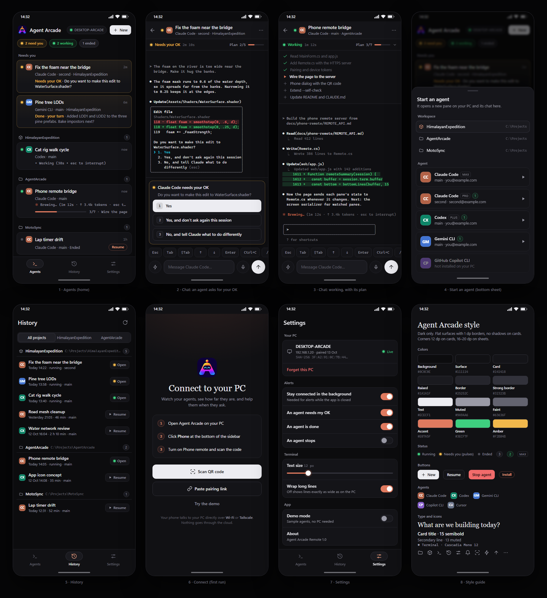

# Agent Arcade Remote: the build plan

An Android app that remote-controls Agent Arcade. On your phone you see every agent's status and how far along it is, you get an alert when one needs you, and you can open its chat: read its terminal, approve or refuse what it asks, answer it, or give it a new instruction. You can also start, stop, resume and rename agents. It looks like the desktop app: the same colors, status dots, icons, agent logos and terminal font.



The phone needs something on the PC to talk to, so the plan has two halves that share one contract, [REMOTE_API.md](REMOTE_API.md):

```
Phone app  ── HTTPS + WebSocket (Wi-Fi or Tailscale, no Agent Arcade server) ──  Agent Arcade "Phone remote"  ──  your agent panes
```

Steps 1 and 2 can run at the same time.

## Step 1: the PC side ("Phone remote" in Agent Arcade)

1. In Agent Arcade, select the **AgentArcade** workspace and start Claude Code (or Codex) in it.
2. Paste **[step1-PC-prompt-for-Claude-Code.txt](step1-PC-prompt-for-Claude-Code.txt)**.
3. When it reports that it works, install the new build with `install.ps1`. The install needs Agent Arcade closed, and closing it stops the running agents, so do this when they're done.

## Step 2: create the Android project with AI

1. Android Studio → **New Project** → **Create with AI**.
2. Paste **[step2-Android-Create-with-AI-prompt.txt](step2-Android-Create-with-AI-prompt.txt)** into the text box. If the box won't take all of it, paste the first two paragraphs there and the rest as your first message in Agent Mode.
3. Attach the mockups from `mockups/`: `00-overview.png`, `01-agents.png`, `02-chat-needs-ok.png`, `03-chat-working.png` and `08-style-guide.png`. If it takes only one image, use `00-overview.png`.
4. **Next**. Name: `Agent Arcade Remote`, package: `com.agentarcade.remote` (since 1.1 the app id is `nl.danular.remote`; the code's namespace stayed `com.agentarcade.remote`), minimum SDK: API 26. **Finish**.
5. Gemini shows a plan first. Check that it has the six screens, the dark theme with the exact colors, the demo data, `@Serializable` models with the listed field names, and no Hilt. If something is missing, ask it to change the plan, then approve it.

Tip: the results get much better with your own Gemini API key: **Settings → Tools → AI → Model Providers → Google AI Studio**.

## Step 3: exact style and the real connection (Agent Mode)

First copy these into the new Android project:

| From this folder | To the Android project |
| --- | --- |
| `android-res/drawable`, `android-res/drawable-nodpi`, `android-res/font` | `app/src/main/res/` (merge with the folders that are there) |
| `REMOTE_API.md` | the project root |
| `android-extras/LICENSE-CascadiaMono.txt` | `app/src/main/assets/licenses/` |

Launcher icon: right-click `app/src/main/res` → **New → Image Asset** → Foreground layer: Image, path `android-extras/launcher-icon-source.png`, resize to about 60% so the whole "A" stays inside round icon masks → Background layer: Color `#0D0139` → Next → Finish.

Then paste these into the Gemini chat in **Agent Mode**, one at a time. After each one let it build and run, look at the result, and commit (**Git → Commit**) so you can always go back.

| Prompt | What it adds |
| --- | --- |
| [step3a-Agent-Mode-exact-look.txt](step3a-Agent-Mode-exact-look.txt) | The desktop app's icons, agent monograms, logo and terminal font, then a check of every screen against the mockups (attach them again) |
| [step3b-Agent-Mode-connect-to-PC.txt](step3b-Agent-Mode-connect-to-PC.txt) | Pairing by QR code or link, pinned HTTPS, the WebSocket, reconnecting, Android 17's local network permission |
| [step3c-Agent-Mode-live-chat.txt](step3c-Agent-Mode-live-chat.txt) | The live terminal, typing, keys, approvals, quick prompts, start / stop / resume |
| [step3d-Agent-Mode-alerts.txt](step3d-Agent-Mode-alerts.txt) | Notifications, staying connected in the background |
| [step3e-Agent-Mode-finish.txt](step3e-Agent-Mode-finish.txt) | Tablets, empty and error states, motion, accessibility, tests, release |

Later, with Claude Code in Android Studio: [step4-Claude-Code-Tailscale-and-sleep.txt](step4-Claude-Code-Tailscale-and-sleep.txt) shows whether the phone is connected over Wi-Fi or Tailscale, connects faster away from home, helps when the PC can't be reached (Tailscale missing or off, the PC asleep), and shows whether the PC may go to sleep (`power` in State).

## Step 4: pair your phone

1. Put the app on your phone: turn on Developer options and USB debugging (or Wireless debugging), pick the phone in Android Studio, and press Run.
2. On the PC: Agent Arcade → **Phone** (bottom of the sidebar) → switch it on. If Windows asks, allow Agent Arcade on private networks. Set the network to *Private* in Windows only if it is your own home network; on shared or public Wi-Fi keep it *Public* and use Tailscale.
3. Click **Pair a phone**. On the phone: **Scan QR code**, check that the fingerprint matches the one on the PC, and tap **Pair**.
4. On the PC, the Phone dialog names the phone and asks whether it may pair: click **Allow** within a minute. Closing the dialog ends the code, but not a question that is already waiting.

Away from home: install [Tailscale](https://tailscale.com) on the PC and the phone with the same account. The pairing link includes the Tailscale address automatically. When the two can't reach each other directly, Tailscale relays the encrypted traffic through its own DERP servers.

## What the phone shows

| Status | Dot | Means |
| --- | --- | --- |
| Working | green | The agent is busy: its "esc to interrupt" line is showing, or output keeps coming after you pressed Enter |
| Needs your OK | amber, pulsing | It asks to run or change something; the chat shows one button per choice |
| Done · your turn | amber, pulsing | It finished its turn and waits for your next message |
| Idle | green | Running and waiting, for example for its first message, or you already looked at it |
| Ended | grey | The agent stopped; Resume continues the chat |

Progress comes from what the agents already show: their live status line (`✻ Brewing… (1m 12s · esc to interrupt)`), their step list (Claude Code's todo list, Codex's plan) shown as "Plan 3/7", and the time since you last pressed Enter. The **Status update** quick prompt asks an agent for a short report in its own words.

## Security

- Phone remote is off until you switch it on, and only listens while it's on.
- Everything is encrypted (HTTPS, TLS 1.2 or 1.3). The phone only accepts your PC's own certificate, whose fingerprint it gets from the QR code.
- Only devices on your own network or your Tailscale network can connect; the port stays closed to the internet. Agent screens and your typing go only between the phone and the PC (over Tailscale, possibly through Tailscale's encrypted DERP relays).
- A pairing code exists only after **Pair a phone**, until the Phone dialog closes, and works once, for 10 minutes. The code alone pairs nothing: the PC names the phone and adds it only after you click **Allow**. **Copy link** keeps the link out of Windows clipboard history and the cloud clipboard. Each phone gets its own token; the PC keeps only a hash of it, and **Remove** in the Phone dialog cuts that phone off at once.
- A paired phone is as powerful as your keyboard in the panes (read, type, approve, start, stop, resume, rename). Agents run with your Windows permissions, so by typing to an agent a phone can reach your files indirectly. It can also make an empty project folder (`POST /projects`). It has no way of its own to read files, change settings or see account logins. Tokens, codes and terminal text never go into any log.

## Troubleshooting

- **The phone can't reach the PC.** Same Wi-Fi? Windows blocks the phone on a *Public* network, and the Phone dialog warns you about it. Set the network to *Private* (Settings → Network & internet → Wi-Fi → your network) only if it is your own home network; on shared or public Wi-Fi keep it *Public* and use Tailscale instead. Did you allow Agent Arcade in the firewall prompt? Is Phone remote on and the PC awake? Guest Wi-Fi networks often block devices from seeing each other. On Android 17 and newer, allow *Nearby devices* for Agent Arcade Remote (Android settings → Apps), or it can't reach addresses on your Wi-Fi.
- **The PC got a new address, or you installed Tailscale after pairing.** The phone learns the new addresses whenever it is connected. If it can't connect at all any more, remove the phone in the Phone dialog and pair again.
- **"This isn't the PC you paired with."** The PC's certificate changed (for example after a Windows reset). Forget the PC in Settings and pair again.
- **No alerts while the app is closed.** Turn on *Stay connected*, allow notifications, and set the app's battery use to *Unrestricted*.
- **An agent shows Idle while it works.** It doesn't print an "esc to interrupt" line; its status follows its output after you press Enter.

## Files

| File | What it is |
| --- | --- |
| `step1-PC-prompt-for-Claude-Code.txt` | Builds Phone remote into Agent Arcade |
| `step2-Android-Create-with-AI-prompt.txt` | The prompt for New Project → Create with AI |
| `step3a` … `step3e` | Follow-up prompts for Gemini's Agent Mode |
| `REMOTE_API.md` | The contract between the PC and the phone |
| `mockups/` | The design: `00-overview.png` and one PNG per screen (made from `mockups.html`) |
| `android-res/` | Android resources made from the desktop app: 39 line icons, the logo, Cascadia Mono (agents show monograms, not vendor logos) |
| `android-extras/` | The launcher icon source and the Cascadia Mono licence |
| `tools/make-assets.ps1` | Rebuilds `android-res/` and `mockups/marks.js` from `web/app.js` |
| `tools/render-mockups.ps1` | Renders the mockups to PNG with Microsoft Edge |

## Later ideas

- Thumbnails of images the agents make, like the strip under a desktop pane
- Reply straight from a notification
- More than one PC
- A Wear OS tile with the "needs you" count
